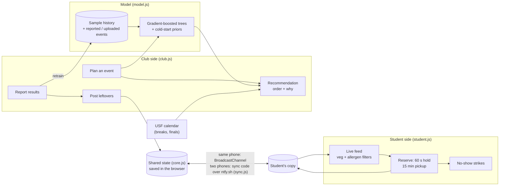

# Bulls Bites

**Order the right amount of food. Rescue what's left.**

HackJam'26 · USF Tampa

Live app: **https://ashita02agrawal-hash.github.io/usf-food-rescue/** (works in any browser, and you can add it to your phone's home screen)

---

## The problem

If you've been to a club meeting at USF, you've seen this. A club gets 70 RSVPs and orders 70 servings of bagels. Twenty people show up, and the rest of the food goes in the trash at the end of the night.

We've watched it happen at our own clubs. An LLC floor event where RSVPs stayed at 40 while attendance dropped to five or six. ACM meetings with trays of bagels left on the table. It wastes club money and it wastes food, and plenty of students on campus would have been glad to eat it.

The problem has two halves, and we built something for each:

1. **Before the event, clubs over-order** because RSVPs are a bad guess at turnout.
2. **After the event, the leftovers have nowhere to go.** By the time someone posts "free food in ENB!" in a group chat, it's already in the trash.

## What Bulls Bites does

### For clubs: plan, then report

- **Plan an event.** Enter the event type, date, time, building, RSVP count and food. Bulls Bites predicts how many people will actually show up and tells you how much to order, in real units like "10 bagels" instead of "73 servings". It also shows how much money and food you save compared with ordering for every RSVP.
- **Why this number?** Every recommendation breaks down what pushed the estimate up or down, like the club's recent show rate, the time slot, or finals week.
- **USF calendar aware.** During Thanksgiving break, spring break and finals, the recommendation automatically scales down.
- **Report results.** After the event, the club enters how many people checked in and how much food was left. The model retrains right away, so the next prediction for that club gets better.
- **Send out the leftovers.** In the same step, the club can post the extra food as a rescue. They add the pickup spot, allergens, whether it's vegetarian, and how long someone will be there handing it out.
- **Insights.** Each club sees its own predicted vs. actual turnout by semester and what drives its turnout. It can also upload past events from a spreadsheet (CSV) to teach the model its history. Any building works, not just a fixed list.

### For students: see it, reserve it, pick it up

- **Home** shows every live post on campus: what the food is, where it is, which club posted it, how many servings are left, and how long until pickup closes.
- **Reserve** 1 or 2 servings. They're held for 60 seconds while you tap "I'm on my way", then you have 15 minutes to get there.
- **Alerts** let you know when a club posts food. You can turn off alerts for allergens you avoid, and set your diet to vegetarian so you only see vegetarian food.
- **Impact** shows how much food you've kept out of the trash.

### Keeping it fair: the no-show rule

If people reserve food and never show up, it doesn't reach anyone. So:

- Canceling within 60 seconds is free.
- A missed pickup or a late cancel counts as a strike.
- 2 strikes in a row, or 3 in a semester, pauses your reservations until next semester. A successful pickup resets the in-a-row count.

The club marks each pickup as done from its own screen, so the counts stay honest. Pickup always closes within two hours of when the food was set out, to follow basic food safety.

## How the prediction works

We didn't use a chatbot for this. The model is a **gradient-boosted decision tree model** written in plain JavaScript with no machine-learning libraries (we built it with help from an AI coding assistant), so it trains in the browser in under a second and retrains the moment a club reports results.

- **What it predicts:** each event's *show rate* (people who checked in ÷ RSVPs), which is then multiplied by the RSVP count.
- **What it looks at:** the club, event type, day, start time, building, RSVP count, week of the semester, exam periods, the club's recent show rate, the club's show rate for that kind of event, and how much food was left last time. It only uses information from *earlier* events, so it never "peeks" at the answer.
- **New clubs** with no history start from campus-wide averages for similar clubs and event types, then shift toward their own pattern after a few events. Buildings the model hasn't seen before work the same way.
- **The order** is the predicted turnout plus a 15% buffer, converted into real units (pizzas, bagels, platters, and so on).

**Results on our sample data:** when we tested on events the model had never seen, it cut wasted food by about **80%** compared with ordering for every RSVP. Its predictions were usually within about **4 people** of actual turnout.

> **About the data:** we don't have real check-in records from USF clubs yet, so every number here comes from **sample data** that we generated to match patterns we've seen on campus (243 events across 13 clubs). Every sample row is labeled as sample data. The next step would be real check-in data from a few clubs to validate the model.

The full model write-up, including a scikit-learn version for comparison and the evaluation scripts, is in [`model/README.md`](model/README.md).

## Architecture

Everything runs in the browser. There's no backend server and no database: the app is static files on GitHub Pages, the model trains on the phone, and app data is saved in the browser.



- **Hosting:** GitHub Pages serves the `web/` folder. A GitHub Actions workflow redeploys it on every merge to `main`.
- **Installable app:** a web app manifest and a service worker (`sw.js`) let it install on a phone's home screen and keep loading on bad Wi-Fi.
- **Sync:** tabs on the same device sync instantly. Two phones sync through a short sync code over the free ntfy.sh relay, which only ever carries demo data.
- **Tech:** plain HTML, CSS and JavaScript (no framework), Poppins font, and a gradient-boosted tree model in plain JavaScript with no machine-learning libraries. There's also a Python/scikit-learn copy of the model for evaluation, plus Node tests that check both versions agree.

## Try it

Open the **[live app](https://ashita02agrawal-hash.github.io/usf-food-rescue/)** and tap **Start demo** to see the club and student sides together. On a phone, add it to your home screen and it opens like a normal app.

To run it on your own computer, from this folder:

```bash
python3 -m http.server 8000 --directory web
```

Then open http://localhost:8000. There's nothing to install and no build step.

**Two-phone demo:** log in as a club on one phone, open *Demo tools* at the bottom of the page, and create a sync code. Open the join link on a second phone logged in as a student. Posts, reservations and pickups then show up on both phones within a second.

## The team

| Who | What they built |
|---|---|
| **Ashita Agrawal** | Club side: event planning, the recommendation screen, reporting results, Insights and CSV upload, the USF calendar. Also pulled everything together into one app: the shared design and the phone layout. |
| **Rithva Menon** | Student side: the home feed, reserving and confirming food, the pickup timer, impact and profile screens, and the club logos. |
| **Nguyen Dang** | The model: the features, the gradient-boosted trees, cold-start handling for new clubs, the sample data generator, and the evaluation and tests. |

## How we used AI

We used an AI coding assistant as a helper while we built this, mostly to:

- talk through the model design and check our feature ideas for "peeking" at future data,
- debug merge conflicts and layout problems, especially on phones,
- write first drafts of repetitive code and styles that we then edited and tested ourselves.

The idea, the product decisions, the no-show rules and the demo all came from us. Every feature was checked by clicking through it in the app. The turnout model itself doesn't use AI at all. It's a small statistical model trained only on event data, and it runs on your phone with no outside service.

## What's in the repo

```
web/                  the app (plain HTML, CSS and JavaScript, no framework)
  js/club.js          club side: plan, report, rescue, insights
  js/student.js       student side: feed, reserve, pickup, profile
  js/model.js         the turnout model (trains in the browser)
  js/core.js          shared data, rules and helpers
  js/sync.js          live sync between two phones
  js/app.js           login screen, demo tools, startup
  css/                styles (one shared USF theme)
  data/               sample event history the app learns from
model/                Python version of the model, evaluation and parity tests
tests/                app flow tests (run with node --test)
data/                 the same sample data as a spreadsheet, plus an example upload
```

## What's next

- Real check-in data from a few USF clubs to validate the model.
- A campus map, so students can see which posts are closest.
- USF single sign-on instead of the demo login.
- A short weekly report for clubs: money saved, food rescued.
